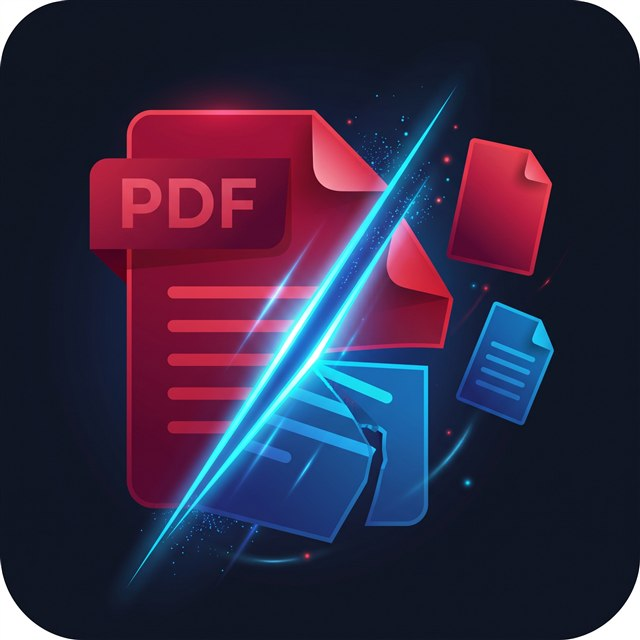

# SlicePDF Studio

<p align="center">
  
</p>

<p align="center">
  <strong>Precision 100% Offline PDF Splitter, Page Verifier & Range Merger for Android & iOS</strong><br/>
  <em>Engineered & Built by <strong>Plexus Labs & Systems LTD</strong></em>
</p>

---

## 📲 Direct Android APK Downloads (v1.0.2)

Click a link below on your Android phone (in **Chrome**) to download and install **SlicePDF Studio** directly from GitHub:

| Package | Best For | Size | Direct Download Link |
| :--- | :--- | :--- | :--- |
| **Universal APK (Recommended)** | **All Android Phones** (32-bit & 64-bit ARM) | `19.9 MB` | [**⬇ Download Universal APK**](https://github.com/Mufti-IBAK/pdf_spliter_studio/raw/main/SlicePDF_Studio_PlexusLabs.apk) |
| **64-Bit ARM APK (`arm64-v8a`)** | **Modern Phones (2020–2026)** — Smaller & Faster | `12.4 MB` | [**⬇ Download 64-Bit APK**](https://github.com/Mufti-IBAK/pdf_spliter_studio/raw/main/SlicePDF_Studio_PlexusLabs_64bit.apk) |
| **32-Bit ARM APK (`armeabi-v7a`)** | **Older 32-Bit Android Phones** | `12.0 MB` | [**⬇ Download 32-Bit APK**](https://github.com/Mufti-IBAK/pdf_spliter_studio/raw/main/SlicePDF_Studio_PlexusLabs_32bit.apk) |

### Installation Instructions on Android
1. Tap the [**⬇ Download Universal APK**](https://github.com/Mufti-IBAK/pdf_spliter_studio/raw/main/SlicePDF_Studio_PlexusLabs.apk) link above in **Google Chrome**.
2. Once the download completes, tap **Open** directly inside Chrome (or open it from your phone's built-in **File Manager** -> **Downloads**).
3. Tap **Install** when prompted by Android Package Installer.

---

## ✨ Key Features

- **Exact Start & End Page Range Extraction:** Extract any page range (e.g., pages `245–256` from a `300+` page PDF) in seconds.
- **Side-by-Side Boundary Page Verification (`BookendPreviewCard`):** Instantly inspect the exact **Start Page** and **End Page** side-by-side so you never cut a sentence or table in half.
- **Interactive Range Filmstrip (`RangeFilmstrip`):** Scroll through every page inside your selected range, rotate individual pages (`90°`), or toggle specific pages out of the export.
- **Full-Screen Pinch-to-Zoom Inspector (`PageZoomModal`):** Tap any page thumbnail to inspect fine print at up to `5x` magnification.
- **Multi-Range Queue (Separate PDFs or Merge into 1 PDF):** Queue multiple page ranges from the same document and choose whether to export them as **Separate `.pdf` Files** or **Merge All Ranges into 1 Combined `.pdf`**.
- **Configurable Default Save Location:** Choose your preferred default phone folder in **Settings** (`/storage/emulated/0/Download/SlicePDF_Studio`, `Download`, `Documents`, or custom folder).
- **100% Offline & Private:** Zero cloud uploads, zero servers, zero watermarks. All PDF rendering and byte extraction run locally on your device.

---

## 🗂 Project Structure

```text
lib/
├── main.dart                          # Application entry point & global error handling
├── theme/
│   └── app_theme.dart                 # Material 3 compact theme & typography
├── models/
│   ├── split_range.dart               # Page range model with per-page rotation & exclusions
│   └── saved_split_file.dart          # Saved split metadata model
├── services/
│   ├── pdf_render_service.dart        # Serialized native PDF page renderer with LRU cache
│   ├── pdf_split_service.dart         # PDF page extractor, multi-range merger & 300-page demo generator
│   └── storage_service.dart           # Direct phone storage writer, default save folder & history
├── screens/
│   ├── splash_screen.dart             # Launch screen with Plexus Labs & Systems LTD branding
│   ├── home_screen.dart               # Document picker, Quick Pick scanner, 300-page demo & Saved Splits
│   ├── workspace_screen.dart          # Main PDF splitting studio & multi-range queue
│   ├── page_zoom_modal.dart           # Full-screen interactive pinch-to-zoom page verifier
│   ├── export_success_screen.dart     # Export confirmation, in-app PDF reader & native share
│   └── settings_screen.dart           # Default Save Location selector & ownership details
└── widgets/
    ├── bookend_preview_card.dart      # Side-by-side Start Page & End Page verification card
    ├── range_filmstrip.dart           # Horizontal scrollable filmstrip of selected range pages
    └── pdf_page_thumbnail.dart        # Cached high-DPI PDF page thumbnail widget
```

---

## 🛠 Building from Source

### Prerequisites
- Flutter SDK (`>=3.11.0`)
- Android Studio / Android SDK (Java 17 JBR)

### Run in Debug Mode
```bash
flutter pub get
flutter run
```

### Build Signed Release APKs
```bash
# Build split-ABI APKs (64-bit & 32-bit)
flutter build apk --release --split-per-abi

# Build Universal ARM APK (32-bit + 64-bit combined)
flutter build apk --release --target-platform android-arm,android-arm64
```

---

## 🏢 Ownership & Credits

**Engineered & Built by Plexus Labs & Systems LTD**  
Document Engineering & Mobile Systems Division  
© 2026 Plexus Labs & Systems LTD. All rights reserved.
